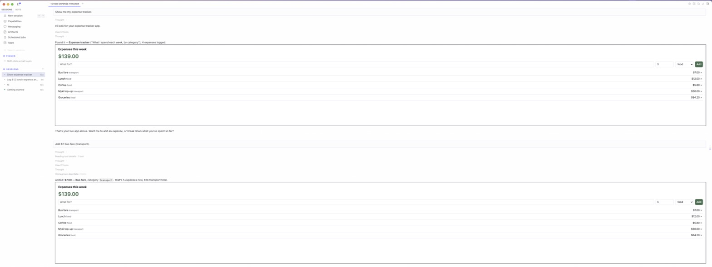

# Homegrown

Hermes builds you small apps that stay.

Ask for an expense tracker, a reading list, a lead tracker or a run log, and Hermes builds it as a real app with its own saved data. It shows up inline in the chat and on the **Apps** page in Hermes Desktop, and it's still there tomorrow. Because the data belongs to the app rather than the conversation, Hermes can use it from anywhere: say "spent $12 on coffee" in Telegram and the tracker open on your desktop updates live.



## What you get

- **Apps that persist.** Each app is one self-contained HTML document plus its own SQLite data. Everything lives under `<hermes home>/plugin-data/homegrown/`, so backing up is copying a folder.
- **Hermes can use them too.** `homegrown_app_data` reads and writes an app's records from any chat or platform, and every open copy of the app refreshes live.
- **Safe to change.** Every code change is a new version. Roll back with one call, and the data is never touched by a code change. Deleted apps go to `trash/` and can be restored.
- **Contained.** Apps run in Desktop's sandboxed frame (opaque origin) with a Content-Security-Policy that blocks all network access. An app can only read and write its own data, through a message bridge the Desktop half scopes to that app. It can't reach other apps, Hermes, your files or the internet.

## Tools

| Tool | What it does |
|---|---|
| `homegrown_create_app` | Build a new app from one HTML document |
| `homegrown_update_app` | Publish a new version, or roll back with `restore_version` |
| `homegrown_list_apps` | List apps with their collections and record counts |
| `homegrown_read_app` | Read an app's code, history and collections |
| `homegrown_app_data` | List, add, update or delete an app's records |
| `homegrown_delete_app` | Move an app to trash |

The bundled skill `homegrown:build-app` teaches the agent the `window.app` API (`list`, `add`, `update`, `remove`, `onChange`, `ask`) and how to build apps that work in the sandbox.

## Install

```bash
hermes plugins install homegrown
hermes plugins enable homegrown
```

Then turn on **Homegrown** in Desktop under **Capabilities → Plugins**. Try: *"Build me an expense tracker with categories and a weekly total."*

## Disclosure

- No network calls, no shell commands, no background processes, no credentials, no telemetry.
- Writes only under `<hermes home>/plugin-data/homegrown/`.
- The Desktop half renders HTML that the agent writes, inside the SDK's `SandboxedFrame` with network blocked by CSP. An app can send a prompt to Hermes (`app.ask`) only into a visible chat composer, as a normal user turn.
- Registers backend routes under `/api/plugins/homegrown/` for the Desktop half.

## Develop

```bash
python3 tests/test_homegrown.py          # store + tool handlers, no Hermes needed
hermes plugins validate .                # the catalog's admission check
ln -s "$PWD" ~/.hermes/plugins/homegrown # live-reload the Desktop half
```

## Licence

Apache-2.0
